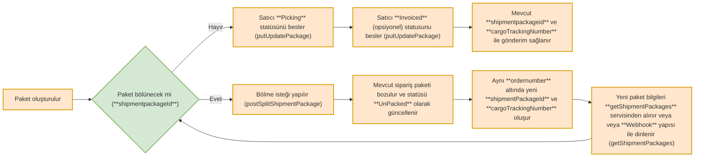

# Sipariş Paketlerini Bölme (splitShipmentPackage)

Bu servis ile Trendyol üzerinde oluşmuş siparişlerinizi birden fazla paket haline getirebilirsiniz. Bu servisi kulandıktan sonra sipariş numarasına bağlı yeni paketler "UnPacked" statüsünde, asenkron olarak oluşacaktır. Bu nedenle [Sipariş Paketlerini Çekme](https://integration-documentation-udwy.readme.io/docs/sipari%C5%9F-paketlerini-%C3%A7ekme-getshipmentpackages) servisinden tekrar güncel paketleri çekmelisiniz.

<div class="diagram-zoomable-tr" tabindex={0}>
  <DiagramDownload />



</div>

<br />

<br />

<br />

<div style={{position: "relative", width: "100%", maxWidth: "900px"}}>
  <video controls playsInline style={{width: "100%", height: "auto", borderRadius: "12px"}}>
    <source src="https://video-content.dsmcdn.com/prod/720p/2019922/2022913/2035874/4666d9c5-c8ae-4cbb-ac9a-3aa815dfe28d.mp4" type="video/mp4" />

    Your browser does not support the video tag.
  </video>
</div>

<Callout icon="🤖" theme="default">
  ###

  Not: Bu videodaki seslendirme ve içerikler, dokümantasyon kaynaklarımız kullanılarak Google NotebookLM yapay zekası ile oluşturulmuştur.
</Callout>

<br />

#### Sipariş Paketlerini Birden Fazla Barkod İle Bölme

Bu servisi kulandıktan sonra sipariş numarasına bağlı yeni paketler asenkron olarak oluşacaktır. Bu nedenle [Sipariş Paketlerini Çekme](https://integration-documentation-udwy.readme.io/docs/sipari%C5%9F-paketlerini-%C3%A7ekme-getshipmentpackages) servisinden tekrar güncel paketleri çekmelisiniz.

Bu method ile bir sipariş paketinin içerisinde olan ürünleri miktar ve ilgili barkodun orderLineId değeri ile pakette toplayarak işlem yapabilirsiniz.

* Eğer istek atarken dışarıda bıraktığınız bir ürün/ler olursa o ürün/ler ayrı ve yeni bir pakette oluşacaktır.

### **POST** splitMultiPackageByQuantity

<NoLinkCallout type="info" title="PROD">
  [https://apigw.trendyol.com/integration/order/sellers/\{sellerId}/shipment-packages/\{packageId}/split-packages](https://apigw.trendyol.com/integration/order/sellers/\{sellerId}/shipment-packages/\{packageId}/split-packages)
</NoLinkCallout>

<NoLinkCallout type="info" title="STAGE">
  [https://stageapigw.trendyol.com/integration/order/sellers/\{sellerId}/shipment-packages/\{packageId}/split-packages](https://stageapigw.trendyol.com/integration/order/sellers/\{sellerId}/shipment-packages/\{packageId}/split-packages)
</NoLinkCallout>

**Örnek Servis İsteği**

```json
{
  "splitPackages": [
    {
      "packageDetails": [
        {
          "orderLineId": 12345,
          "quantities": 2
        },
        {
          "orderLineId": 123456,
          "quantities": 1
        }
      ]
    },
    {
      "packageDetails": [
        {
          "orderLineId": 123,
          "quantities": 1
        },
        {
          "orderLineId": 1234,
          "quantities": 1
        }
      ]
    }
  ]
}
```

### **POST** splitShipmentPackage

<NoLinkCallout type="info" title="PROD">
  [https://apigw.trendyol.com/integration/order/sellers/\{sellerId}/shipment-packages/\{packageId}/split](https://apigw.trendyol.com/integration/order/sellers/\{sellerId}/shipment-packages/\{packageId}/split)
</NoLinkCallout>

<NoLinkCallout type="info" title="STAGE">
  [https://stageapigw.trendyol.com/integration/order/sellers/\{sellerId}/shipment-packages/\{packageId}/split](https://stageapigw.trendyol.com/integration/order/sellers/\{sellerId}/shipment-packages/\{packageId}/split)
</NoLinkCallout>

**Örnek Servis İsteği**

```json
{
 "orderLineIds": [{orderLineId}]
}
```

#### Sipariş Paketlerini Bölme (Tek Request İle Birden Fazla Paket Oluşturma)

Bu servisi kulandıktan sonra sipariş numarasına bağlı yeni paketler asenkron olarak oluşacaktır. Bu nedenle [Sipariş Paketlerini Çekme](https://integration-documentation-udwy.readme.io/docs/sipari%C5%9F-paketlerini-%C3%A7ekme-getshipmentpackages) servisinden tekrar güncel paketleri çekmelisiniz.

### **POST** splitShipmentPackage

<NoLinkCallout type="info" title="PROD">
  [https://apigw.trendyol.com/integration/order/sellers/\{sellerId}/shipment-packages/\{packageId}/multi-split](https://apigw.trendyol.com/integration/order/sellers/\{sellerId}/shipment-packages/\{packageId}/multi-split)
</NoLinkCallout>

<NoLinkCallout type="info" title="STAGE">
  [https://stageapigw.trendyol.com/integration/order/sellers/\{sellerId}/shipment-packages/\{packageId}/multi-split](https://stageapigw.trendyol.com/integration/order/sellers/\{sellerId}/shipment-packages/\{packageId}/multi-split)
</NoLinkCallout>

**Örnek Servis İsteği**

Örnekte paket içerisineki 3,5,6 orderLine’ları için bir paket, 7,8,9 orderLine’ları için başka bir paket ve kalan orderLine’lar için de bir tane olmak üzere 3 paket oluşacaktır.

* Bir paket üzerinde üzerindeki bütün orderLine’lar bu servis gönderilmemelidir. Kalan orderLine’lar için otomatik paket zaten sistem tarafından yaratılacaktır.

```json
{
    "splitGroups": [{
            "orderLineIds": [
                3, 5, 6
            ]
        },
        {
            "orderLineIds": [
                7, 8, 9
            ]
        }

    ]
}
```

#### Sipariş Paketlerini Barkod Bazlı Bölme

Bu servisi kulandıktan sonra sipariş numarasına bağlı yeni paketler asenkron olarak oluşacaktır. Bu nedenle [Sipariş Paketlerini Çekme](https://integration-documentation-udwy.readme.io/docs/sipari%C5%9F-paketlerini-%C3%A7ekme-getshipmentpackages) servisinden tekrar güncel paketleri çekmelisiniz.

### **POST** splitShipmentPackageByQuantity

<NoLinkCallout type="info" title="PROD">
  [https://apigw.trendyol.com/integration/order/sellers/\{sellerId}/shipment-packages/\{packageId}/quantity-split](https://apigw.trendyol.com/integration/order/sellers/\{sellerId}/shipment-packages/\{packageId}/quantity-split)
</NoLinkCallout>

<NoLinkCallout type="info" title="STAGE">
  [https://stageapigw.trendyol.com/integration/order/sellers/\{sellerId}/shipment-packages/\{packageId}/quantity-split](https://stageapigw.trendyol.com/integration/order/sellers/\{sellerId}/shipment-packages/\{packageId}/quantity-split)
</NoLinkCallout>

**Örnek Servis İsteği**

```json
{
  "quantitySplit": [
    {
      "orderLineId": 0,
      "quantities": [
       2,2
       ]
    }
  ]
}
```

<br />