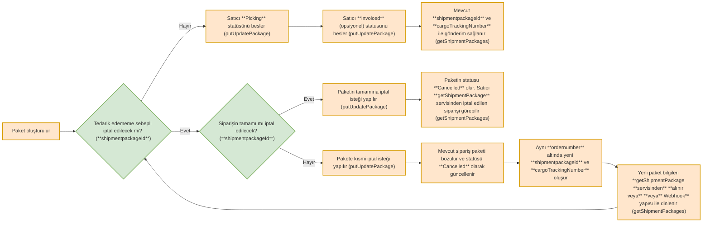

# Tedarik Edememe Bildirimi (updatePackage)

Tedarikçinin paket içerisindeki ürünlerden bir ya da birkaçını Tedarik Edememe kaynaklı iptal etmesi için kullanılır. Bu method yardımıyla yapılan bir iptal sonrası, iptal edilen paket bozularak yeni ID’li bir paket oluşturulacaktır.

* Tedarik edememe bildirimi yapıldıktan sonra Trendyol Order Management System tarafından aynı orderNumber üzerinde yeni bir ShipmentPackageID oluşturulmakta ve daha önceki shipmentpackage iptal edilmektedir. Bu durumda Tedarik Edememe kaydı yapıldıktan sonra tekrar [Sipariş Paketlerini Çekme](https://integration-documentation-udwy.readme.io/docs/sipari%C5%9F-paketlerini-%C3%A7ekme-getshipmentpackages) işlemi yapılması gerekmektedir.

<div class="diagram-zoomable-tr" tabindex={0}>
  <DiagramDownload />



</div>

### **PUT** updatePackage

<NoLinkCallout type="info" title="PROD">
  [https://apigw.trendyol.com/integration/order/sellers/\{sellerId}/shipment-packages/\{packageId}/items/unsupplied](https://apigw.trendyol.com/integration/order/sellers/\{sellerId}/shipment-packages/\{packageId}/items/unsupplied)
</NoLinkCallout>

<NoLinkCallout type="info" title="STAGE">
  [https://stageapigw.trendyol.com/integration/order/sellers/\{sellerId}/shipment-packages/\{packageId}/items/unsupplied](https://stageapigw.trendyol.com/integration/order/sellers/\{sellerId}/shipment-packages/\{packageId}/items/unsupplied)
</NoLinkCallout>

**Örnek Servis İsteği**

```json
{
 "lines": [
   {
     "lineId": 0,
     "quantity": 0
   }
 ],
"reasonId":0
 }
```

**Tedarik Edememe Nedenleri**

| reasonId | name                      | description                                                                                                                   |
| :------- | :------------------------ | :---------------------------------------------------------------------------------------------------------------------------- |
| 500      | Stok tükendi              | Ürünün stoğu tükenmesi ve gönderimin gecikmesi gibi sebeplerle tedarik edilememesi durumunda seçilmelidir.                    |
| 501      | Kusurlu/Defolu/Bozuk Ürün | Ürün kusurlu/defolu/bozuk olduğu için gönderilememesi durumunda seçilmelidir.                                                 |
| 502      | Hatalı Fiyat              | Yanlış fiyat beslenmesi durumunda seçilmelidir.                                                                               |
| 504      | Entegrasyon Hatası        | Entegrasyon firmasından kaynaklı olarak hatalı fiyat ya da stok aktarımında yaşanan sorunlarda seçilmelidir.                  |
| 505      | Toplu Alım                | Üründe yapılan indirim sonrası tek bir üründen ve aynı müşteri tarafından toplu olarak satın alınması durumunda seçilmelidir. |
| 506      | Mücbir Sebep              | Doğal afet, hastalık, cenaze vb. durumlarda seçilmelidir                                                                      |

<br />